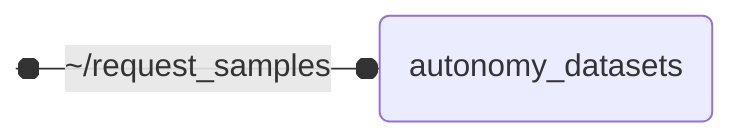

# `autonomy_datasets`

Integrates automated driving datasets into the ROS 2 ecosystem

## Nodes

### `autonomy_datasets`

Samples are published as fast as the playback advances until the first request is received on the
`request_samples` service. From then on, playback is controlled by the requesting node, e.g. by a
benchmark that evaluates every sample it receives: samples are only published while a request is
being processed, and a request is answered once its samples have been published. Start the node
with `start_paused:=true` to publish no sample before the first request.

Samples are identified by their position within the playback pass, starting at 0. Since playback
cannot rewind, requested samples that have already been passed are reported as not published.

```bash
# publish the next sample and wait until it has been published
ros2 service call /datasets/request_samples autonomy_datasets_msgs/srv/RequestSamples "{mode: 1, num_samples: 1}"

# publish selected samples, skipping all samples in between
ros2 service call /datasets/request_samples autonomy_datasets_msgs/srv/RequestSamples "{mode: 2, sample_ids: [10, 12, 15]}"

# publish all remaining samples and wait for the end of the dataset
ros2 service call /datasets/request_samples autonomy_datasets_msgs/srv/RequestSamples "{mode: 0}"
```

##### Selecting Topics

The topics of all datasets follow the same naming scheme, e.g. `camera_01/image_raw`,
`lidar_01/point_cloud` or `object_list/lidar_01`. The published topics are selected by patterns of
their names: a topic is published if it matches any pattern of `include_topics` and no pattern of
`exclude_topics`. Patterns are shell-style wildcards matched against the complete topic name, where
`*` also matches `/`, and a pattern also matches the topics below the namespace it names, e.g.
`object_list/lidar_01` also matches `object_list/lidar_01/meta_info`. The data of topics that are
not published is not loaded, and the same selection applies when replaying rosbags, also with
`replay_only:=true`.

```yaml
/**/*:
  ros__parameters:
    include_topics: ["*"]
    exclude_topics: ["camera_*", "radar_*", "lidar_0[2-9]", "lidar_1*", "object_list/*/meta_info"]
```

ROS ignores empty lists in parameter files, so a parameter file that excludes no topic while
overriding another one sets `exclude_topics: [""]`.

##### Streaming Rosbags from S3

Existing rosbags can be replayed from an S3 bucket, e.g. on a MinIO server, without downloading them
first. They are stored there with the same layout as below `datasets_path`, i.e. in
`<rosbag_s3_url>/<dataset>/bags/<version>/<rosbag>/`. Only the parts of a rosbag that hold messages
of the published topics are downloaded, so that e.g. camera images are not transferred with
`exclude_topics: ["camera_*"]`. With `replay_only:=true`, the topics stored in the rosbags that are
selected by `include_topics` and `exclude_topics` are published.

```bash
export AWS_ACCESS_KEY_ID=<access key> AWS_SECRET_ACCESS_KEY=<secret key>
ros2 launch autonomy_datasets autonomy_datasets.launch.py dataset:=nuscenes replay_only:=true \
  rosbag_s3_url:=s3://<bucket>/<prefix> s3_endpoint_url:=https://<minio server>:9000
```

A rosbag can only be downloaded selectively if each of its messages is stored in an MCAP chunk of
its own, which is how rosbags are written (see `chunkSize` in
[`mcap_storage_config.yaml`](config/mcap_storage_config.yaml)). Rosbags written with larger chunks
are still streamed, but download most of their sensor data along with the other topics; regenerate
them with `overwrite_rosbag:=true` before uploading them. The map of a scene is stored as a file in
the directory of each rosbag, so that a rosbag directory can be uploaded as it is.



#### Service Servers

| Service | Type | Description |
| --- | --- | --- |
| `~/request_samples` | `autonomy_datasets_msgs/srv/RequestSamples` | publish samples of the dataset on request, answered once the requested samples have been published |

#### Parameters

| Parameter | Type | Default | Description |
| --- | --- | --- | --- |
| `datasets_path` | `string` | `/datasets` | path to datasets directory |
| `dataset` | `string` | `waymo_open_dataset` | name of the dataset to use |
| `include_topics` | `string[]` | `[*]` | patterns of the topics of the dataset to publish, e.g. 'camera_*' or 'object_list/lidar_01'; '*' matches any characters, including '/', and a pattern also matches the topics below the namespace it names; '/clock' is always published |
| `exclude_topics` | `string[]` | `[]` | patterns of the topics of the dataset not to publish, even if they match 'include_topics', e.g. 'radar_*' or 'object_list/*/meta_info' |
| `rosbag_s3_url` | `string` | - | S3 URI of a datasets directory to stream existing rosbags from instead of reading them from 'datasets_path', e.g. 's3://bucket/datasets'; credentials are read from the environment variables 'AWS_ACCESS_KEY_ID' and 'AWS_SECRET_ACCESS_KEY' |
| `s3_endpoint_url` | `string` | - | URL of the S3 server to stream rosbags from, e.g. 'https://minio.example.com:9000'; taken from the environment variable 'AWS_ENDPOINT_URL' if empty |
| `dataset_split` | `string` | `validation_mini` | split of the dataset to use |
| `start_paused` | `bool` | `false` | whether to start playback paused, publishing samples only when they are requested via the 'request_samples' service |
| `target_frame_rate` | `float` | `0.0` | playback speed multiplier based on recorded timestamps (1.0 = real-time, 2.0 = double speed, 0.0 = unlimited) |
| `publish_samples` | `bool` | `true` | whether to publish samples to ROS topics |
| `write_rosbag` | `bool` | `true` | whether to write samples to rosbag |
| `overwrite_rosbag` | `bool` | `false` | whether to overwrite existing rosbags instead of replaying them |
| `continue` | `bool` | `false` | whether to continue writing rosbags of the scenes not stored yet, skipping the stored ones |
| `replay_only` | `bool` | `false` | whether to only replay existing rosbags, which does not require the raw data of the dataset |
| `wait_for_ack` | `bool` | `true` | whether to wait for subscriber acknowledgement after publishing |
| `loop` | `bool` | `false` | restart from the beginning after publishing all samples |
| `map_frame_id` | `string` | `map` | TF frame the Lanelet2 map is anchored to |
| `map_contents` | `string` | `BLANK_MAP_CONTENTS` | Lanelet2 map (OSM XML) of the current scene |
| `origin_lat` | `float` | `0.0` | WGS84 latitude of the current scene's map origin |
| `origin_lon` | `float` | `0.0` | WGS84 longitude of the current scene's map origin |
| `waymo_lidar_object_list_filter_cam_front` | `bool` | `false` | use only objects covered by front camera |
| `waymo_min_lidar_points_in_bbox` | `int` | `1` | minimum number of lidar points required in a bounding box |
| `publish_lanelet2_map` | `bool` | `true` | whether to publish each scene's map as a Lanelet2 map via the 'map_contents' parameter |
| `nuscenes_lanelet2_lane_width` | `float` | `3.0` | assumed lane width in meters used to synthesize lane boundaries during Lanelet2 conversion |
| `truckscenes_auto_download` | `bool` | `true` | whether to download and extract TruckScenes when it is not available locally |
| `truckscenes_download_workers` | `int` | `8` | number of TruckScenes release archives to download concurrently |
| `nvidia_filter_countries` | `string` | - | comma-separated list of countries to include (e.g. 'Germany,France'); if empty, includes all countries |
| `driving_auto_download` | `bool` | `true` | whether to download and extract DrivIng when it is not available locally |
| `driving_download_workers` | `int` | `8` | number of DrivIng archive chunks to download concurrently |
| `driving_rosbag_duration_seconds` | `float` | `20.0` | duration of each DrivIng rosbag scene in seconds |
| `tum_traffic_extract_archives` | `bool` | `true` | whether to extract manually downloaded TUM Traffic archives found in the dataset directory |
| `tum_traffic_sync_tolerance_seconds` | `float` | `0.1` | maximum time difference for matching a TUM Traffic sensor to a frame in seconds |
| `tum_traffic_rosbag_duration_seconds` | `float` | `20.0` | duration of each TUM Traffic rosbag scene in seconds |
| `tum_traffic_labels_in_base_frame` | `bool` | `false` | whether TUM Traffic 3D labels are annotated in the station base frame instead of the frame of the sensor they are stored for |
| `zod_anonymization` | `string` | `blur` | anonymization of the published Zenseact Open Dataset camera images (blur, dnat) |
| `zod_image_scale` | `float` | `1.0` | factor the native 3848x2168 Zenseact Open Dataset camera images are scaled by |
| `zod_sync_tolerance_seconds` | `float` | `0.1` | maximum time difference for matching a Zenseact Open Dataset sensor to a frame in seconds |
| `zod_rosbag_duration_seconds` | `float` | `20.0` | duration of each rosbag scene of a Zenseact Open Dataset sequence or drive in seconds |
| `zod_motion_compensate_lidar` | `bool` | `true` | whether to motion-compensate Zenseact Open Dataset point clouds onto the timestamp of the sample they are published in |
| `zod_auto_download` | `bool` | `true` | whether to download the Zenseact Open Dataset when it is not available locally |
| `zod_download_url` | `string` | - | personal Zenseact Open Dataset download link; read from the ZOD_DOWNLOAD_URL environment variable if empty |
| `fzi_aura_scenes` | `string` | - | comma-separated FZI-AURA scene IDs to publish; all scenes of the selected split if empty |
| `fzi_aura_samples` | `string` | `keyframes` | FZI-AURA sample stream to publish (keyframes, all) |
| `fzi_aura_lidar_stage` | `string` | `motion_compensated` | processing stage of the published FZI-AURA lidar point clouds (motion_compensated, raw) |
| `fzi_aura_publish_semantic_labels` | `bool` | `true` | whether to publish the semantic FZI-AURA lidar labels as point fields |
| `fzi_aura_image_scale` | `float` | `1.0` | factor the native FZI-AURA camera images are scaled by |
| `fzi_aura_auto_download` | `bool` | `true` | whether to download FZI-AURA when it is not available locally |
| `fzi_aura_download_layers` | `string` | - | comma-separated FZI-AURA data layers to download; the default selection of the FZI-AURA SDK downloader if empty |
| `publish_lanelet2_map` | `bool` | `true` | whether to publish each scene's map as a Lanelet2 map via the 'map_contents' parameter |
| `fzi_aura_lanelet2_lane_width` | `float` | `3.5` | assumed lane width in meters used to synthesize the lane boundaries of OpenStreetMap roads |
| `fzi_aura_overpass_url` | `string` | `https://overpass-api.de/api/interpreter` | Overpass API endpoint the OpenStreetMap roads of the FZI-AURA Lanelet2 maps are fetched from |

## Launch Files

### [`autonomy_datasets.launch.py`](launch/autonomy_datasets.launch.py)

| Argument | Default | Description |
| --- | --- | --- |
| `request_samples` | `"~/request_samples"` | service to request samples to be published |
| `dataset` | `"fzi_aura"` | dataset name |
| `config` | `""` | path to a parameter file (inferred from 'dataset' if empty) |
| `name` | `"datasets"` | node name |
| `namespace` | `""` | node namespace |
| `log_level` | `"info"` | ros logging level |
| `use_sim_time` | `"true"` | use sim time |
| `datasets_path` | `"/datasets"` | path where raw datasets are stored |
| `start_paused` | `"false"` | publish samples only when they are requested via the request_samples service |
| `target_frame_rate` | `"1.0"` | target frame rate |
| `publish_samples` | `"true"` | publish dataset samples as ros messages |
| `write_rosbag` | `"true"` | write dataset samples to rosbag |
| `continue` | `"false"` | continue writing rosbags of the scenes not stored yet without replaying existing rosbags |
| `overwrite_rosbag` | `"false"` | overwrite existing rosbag instead of replaying |
| `replay_only` | `"false"` | only replay existing rosbags, which does not require the raw data of the dataset |
| `rosbag_s3_url` | `""` | S3 URI of a datasets directory to stream existing rosbags from, e.g. 's3://bucket/datasets' |
| `s3_endpoint_url` | `""` | URL of the S3 server to stream rosbags from (environment variable 'AWS_ENDPOINT_URL' if empty) |
| `wait_for_ack` | `"false"` | wait for subscriber acknowledgement after publishing |
| `loop` | `"false"` | restart from the beginning after publishing all samples |
| `rviz` | `"yes"` | start rviz for visualization |
| `rviz_config` | `""` | path to an rviz configuration file (inferred from 'dataset' if empty) |
| `rviz_start_delay` | `"2.0"` | delay in seconds before starting rviz to let the dataset node expose its parameter services |
